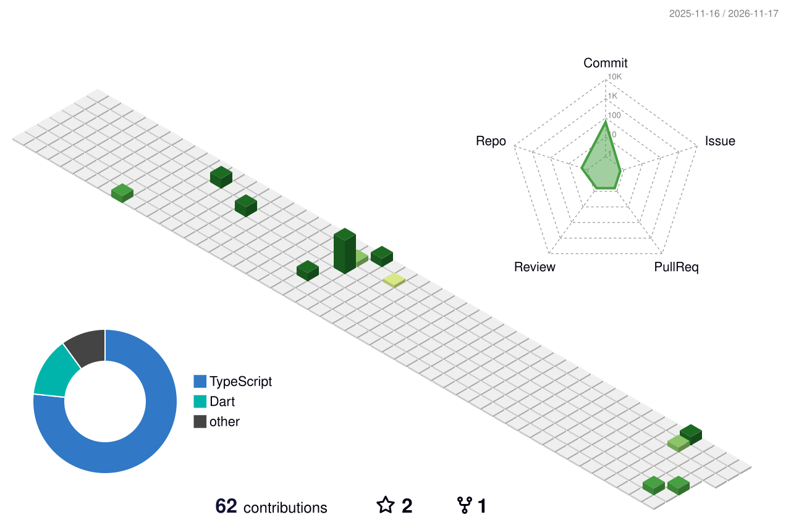
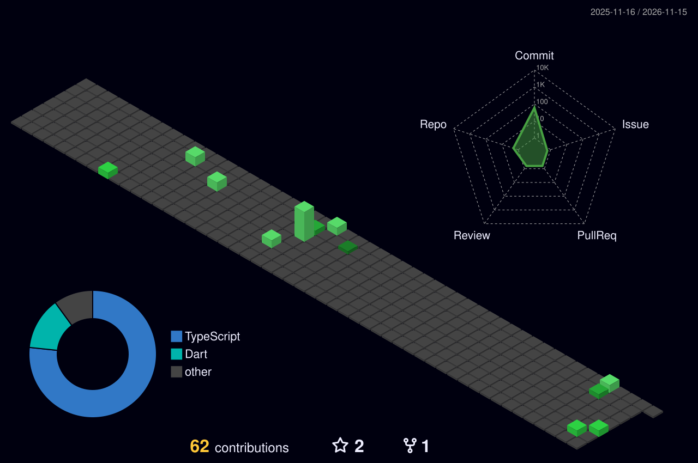

<!--
  GitHub Profile README for github.com/davidnato
  The green 3D contribution skyline is generated by .github/workflows/profile-3d.yml.
  Run that workflow once before expecting the image to render.
-->

> whoami
name: David Wanyama Nato
also_known_as: Wanyii Papah
location: Nairobi, Kenya
education: BSc Information Technology
roles:
  - Flutter & Web Developer
  - Creative Technologist
  - Graphic Designer & Video Editor
currently_exploring:
  - AI Automation
  - Cloud & DevOps
  - Data Engineering
building_for: People, communities, and everyday problems
collaboration: Open to meaningful projects and opportunities
I'm an IT graduate and developer who enjoys building useful, human-centered products—from mobile experiences in Flutter to web applications in React. My interests sit at the intersection of software engineering, thoughtful design, and practical automation.

I believe strong products should be accessible, maintainable, and genuinely helpful, not just technically impressive. Outside development, I also work with visual design, video storytelling, and technology-enabled learning.
<table>
  <tr>
    <td width="50%" valign="top">
      <b>WHAT I BUILD</b>  
      Mobile apps · Web applications · Product prototypes · Practical digital tools
    </td>
    <td width="50%" valign="top">
      <b>WHAT I'M GROWING INTO</b>  
      Backend engineering · AI-powered workflows · Cloud infrastructure · Data-driven systems
    </td>
  </tr>
</table>> toolbox --list

Languages

Frameworks & application development

Tools, workflow & creativity

> projects --featured
<table>
  <tr>
    <td width="50%" valign="top">
      <h3><a href="https://github.com/davidnato/confident_me">ConfidentMe</a></h3>
      A local-first Flutter app for confidence-building and communication practice, with daily challenges, guided breathing, conversation scenarios, journaling, and optional progress tracking.
        
      
      
    </td>
    <td width="50%" valign="top">
      <h3><a href="https://github.com/davidnato/care-connect-webapp">Care Connect</a></h3>
      A web application project built using a modern React and TypeScript stack. A space to experiment with polished, component-driven interfaces and responsive product design.
        
      
      
    </td>
  </tr>
  <tr>
    <td width="50%" valign="top">
      <h3><a href="https://github.com/davidnato/Health-Record-Management-System">Health Record Management</a></h3>
      A Flutter-based project exploring the organization and accessibility of healthcare records, with Firebase included in the project's documented stack.
        
      
      
    </td>
    <td width="50%" valign="top">
      <h3><a href="https://github.com/davidnato/Hostel-Management-Application">Hostel Management Application</a></h3>
      A Flutter application project focused on hostel booking, assignment, and vacating workflows.
        
      
      
    </td>
  </tr>
</table>

  

> contributions --render 3d --palette neon-green

MY CONTRIBUTION SKYLINE

Every green tower represents real GitHub activity; taller blocks mean more contributions on that day.
<!-- Generated automatically by the workflow in .github/workflows/profile-3d.yml. -->

Automatically regenerated daily using actual GitHub contribution data. No artificial contributions or fabricated metrics.

<b>View an alternate midnight-green skyline</b>

 

  

> github --insights

Statistics and language cards are supplied by external services and may occasionally be unavailable or cached; the 3D skyline above is generated in this repository.
> roadmap --next
- [x] Build and publish mobile and web projects.
- [x] Develop a local-first confidence and communication app.
- [ ] Deepen backend engineering, testing, and deployment skills.
- [ ] Build and document practical AI automation solutions.
- [ ] Explore production cloud, DevOps, and data engineering workflows.
- [ ] Collaborate on open-source projects that create everyday value.
> connect --collaborate
I'm interested in software development, useful automation, creative technology, and projects with real-world impact. If you're building something thoughtful or looking to collaborate, I'd be glad to connect.

<em>"Build with purpose. Learn in public. Keep shipping."</em>

